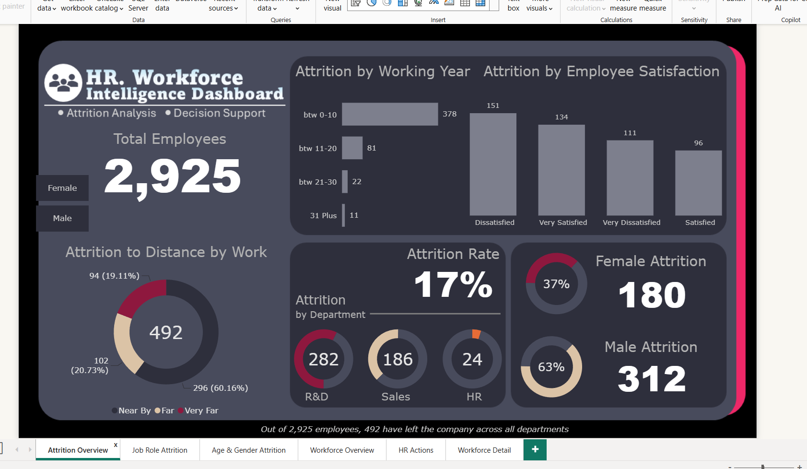
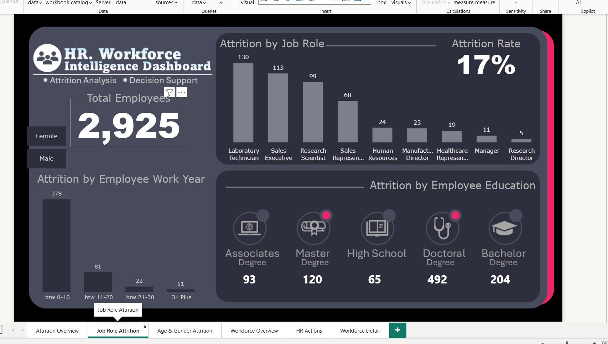
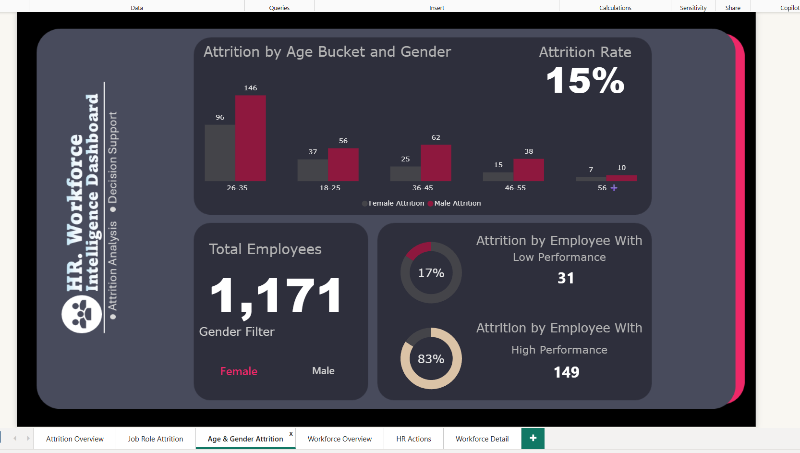
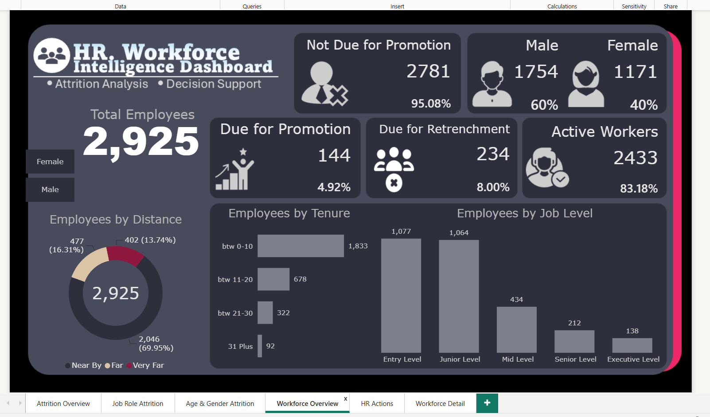
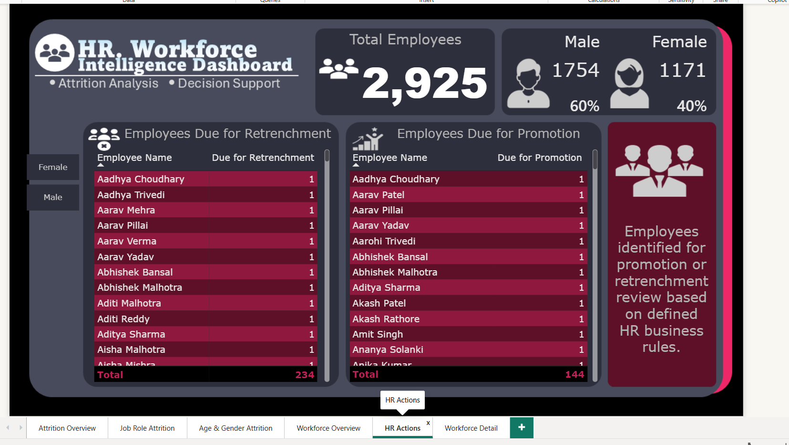
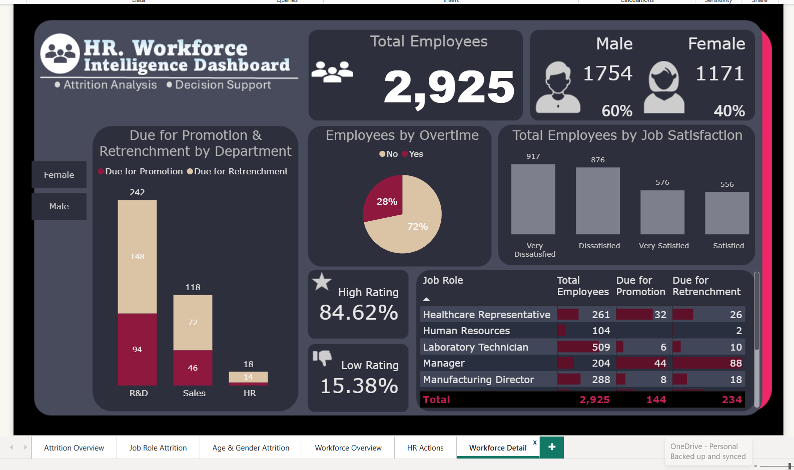
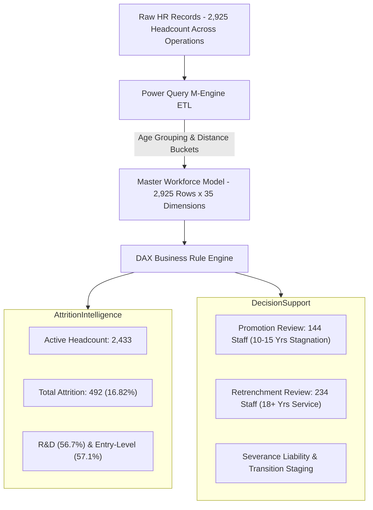

# 👥 HR Workforce Intelligence & Decision Support Dashboard
### Enterprise People Analytics, Attrition Diagnostics & Rule-Based Workforce Decision Support
**Stack:** Microsoft Power BI · Power Query (M) · DAX · Excel Data Modeling · Human Capital Analytics

[](https://powerbi.microsoft.com/)
[](https://learn.microsoft.com/en-us/dax/)
[]()
[]()

---

## 📌 Executive Summary
In modern human resource management, static headcount reporting fails to answer strategic talent questions: *Where is turnover concentrated? Which critical job roles are hemorrhaging talent? And which employees meet organizational criteria for career advancement or workforce rationalization?*

This project delivers an enterprise-grade **HR Workforce Intelligence & Decision Support Dashboard** developed in **Microsoft Power BI**. Built on a unified **2,925-employee master dataset**, the solution seamlessly integrates two core talent pillars across **6 interactive report pages**:
1. **Attrition Analysis Module (Pages 1–3):** Deep diagnostics into employee departures across organizational units, job titles, tenure bands, satisfaction levels, and demographics.
2. **Workforce Decision Support Module (Pages 4–6):** Operational screening engine applying transparent, rule-based logic to surface candidate cohorts for **Promotion Reviews (144 employees)** and **Retrenchment Reviews (234 employees)**.

---

## 🖥️ 6-Page Interactive Power BI Dashboard Previews

The dashboard features an executive dark navy theme with high-contrast magenta and coral accents, organized into a progressive analytical journey:

### 1️⃣ Page 1 — Attrition Overview (Executive Summary)
*High-level baseline tracking Total Headcount (2,925), Attrition Volume (492), Attrition Rate (17%), and departures across Department, Distance to Work, Working Years, and Job Satisfaction.*


---

### 2️⃣ Page 2 — Job Role Attrition (Role-Level Diagnostics)
*Granular breakdown of turnover across organizational roles and education backgrounds, highlighting acute departure volumes in Laboratory Technicians, Sales Executives, and Research Scientists.*


---

### 3️⃣ Page 3 — Age & Gender Attrition (Demographics & Performance)
*Demographic cohort analysis evaluating attrition across standardized age buckets (18–25 through 56+) cross-filtered by gender (312 Male exits, 180 Female exits) and performance appraisal bands.*


---

### 4️⃣ Page 4 — Workforce Overview (Decision Support Baseline)
*Active workforce health monitor tracking Active Employees (2,433), Gender Mix (1,754 Male / 1,171 Female), and organizational ratios for promotion and retrenchment review candidates.*


---

### 5️⃣ Page 5 — HR Actions (Screening Lists for Executive Review)
*Granular employee-level screening tables identifying candidates eligible for Retrenchment Review (234 personnel) and Promotion Review (144 personnel) with transparent policy guidance.*


---

### 6️⃣ Page 6 — Workforce Detail (Multi-Dimensional Deep Dive)
*Comprehensive cross-tabulation detailing promotion and retrenchment cohorts across departments, overtime frequency, job satisfaction quadrants, and full job role distributions.*


---

## 📊 Core Workforce & Decision KPIs

| Metric Indicator | Portfolio Result | Baseline / Share | Strategic & Operational Interpretation |
| :--- | :--- | :--- | :--- |
| **Total Workforce Population** | **2,925 employees** | 100.0% | Complete enterprise employee baseline |
| **Active Headcount** | **2,433 employees** | **83.18%** | Current active operational workforce |
| **Total Employee Exits (Attrition)**| **492 employees** | **16.82% (~17%)** | Cumulative historical attrition volume |
| **Male Population / Attrition** | **1,754 (60.0%)** | **312 exits (17.79%)** | Male headcount representation & exit volume |
| **Female Population / Attrition** | **1,171 (40.0%)** | **180 exits (15.37%)** | Female headcount representation & exit volume |
| **Due for Promotion Review** | **144 employees** | **4.92%** | Stagnant tenure (10–15 yrs since last promotion) |
| **Not Due for Promotion** | **2,781 employees** | **95.08%** | Standard career progression progression pool |
| **Due for Retrenchment Review** | **234 employees** | **8.00%** | Extended tenure (≥18 years at company) |
| **Top Attrition Department** | **R&D (282 exits)** | 57.3% of exits | Primary operational departure concentration |
| **Second Attrition Department** | **Sales (186 exits)** | 37.8% of exits | High-turnover client-facing division |
| **Primary Risk Tenure Band** | **0 – 10 Years** | Acute concentration| Peak vulnerability during initial career ramp |

---

## 🎯 Business Rules & Decision Support Logic

The decision support module operationalizes standard corporate HR review policies into automated screening indicators:

```text
┌─────────────────────────────────────────────────────────────────────────────┐
│                          HR Business Review Rules                           │
├───────────────────────────────┬─────────────────────────────────────────────┤
│ Rule Category                 │ Exact Logic & Criteria                      │
├───────────────────────────────┼─────────────────────────────────────────────┤
│ 1. Promotion Review Rule      │ Years Since Last Promotion >= 10 AND <= 15  │
│                               │ ➔ Identifies career stagnation (144 Staff)  │
├───────────────────────────────┼─────────────────────────────────────────────┤
│ 2. Retrenchment Review Rule   │ Years At Company >= 18                      │
│                               │ ➔ Identifies restructuring cohort (234)     │
└───────────────────────────────┴─────────────────────────────────────────────┘
```

> [!NOTE]
> **Responsible AI & Decision-Support Principle:**
> The promotion and retrenchment flags serve purely as **analytical screening filters** for HR talent councils, not automated employment actions. All candidates require individualized managerial review, performance appraisal verification, and departmental budget alignment.

---

## 🏗️ Data Architecture & Pipeline



---

## 💻 Core DAX Formulas

### 1. Headcount & Attrition Baseline
```dax
Total Employees = 
COUNTROWS('HR Master Data')

Total Attrition = 
CALCULATE(
    [Total Employees],
    'HR Master Data'[Attrition] = "Yes"
)

Active Employees = 
CALCULATE(
    [Total Employees],
    'HR Master Data'[Attrition] = "No"
)

Attrition Rate = 
DIVIDE([Total Attrition], [Total Employees], 0)
```

### 2. Decision Support Measures
```dax
Due for Promotion = 
CALCULATE(
    [Total Employees],
    'HR Master Data'[Promotion Status] = "1"
)

Due for Retrenchment = 
CALCULATE(
    [Total Employees],
    'HR Master Data'[Retrenchment Status] = "1"
)

Promotion % = 
DIVIDE([Due for Promotion], [Total Employees], 0)

Retrenchment % = 
DIVIDE([Due for Retrenchment], [Total Employees], 0)
```

---

## 💡 Technical Challenge & Resolution

### Data Type Filter Mismatch (String vs. Integer)
- **Challenge:** During initial DAX measure validation, `[Due for Promotion]` returned zero or evaluation errors because `[Promotion Status]` was imported as a Text column (`"1"` / `"0"`), whereas the initial DAX filter compared against numeric integer `1`.
- **Root-Cause Analysis:** Power BI strict type evaluation prevented implicit coercion within the `CALCULATE` filter predicate.
- **Resolution:** Explicitly updated the measure to filter against string literal `"1"`:
  ```dax
  Due for Promotion = 
  CALCULATE(
      [Total Employees],
      'HR Master Data'[Promotion Status] = "1"
  )
  ```
- **Key Takeaway:** Always verify column data types in Model View before writing logical DAX predicates.

---

## 🔍 Key Business Findings & Strategic Recommendations

1. **R&D Department Departure Concentration:**
   - **Finding:** R&D accounts for **282 out of 492 total exits (57.3%)**, with high turnover clustered among Laboratory Technicians and Research Scientists.
   - **Recommendation:** Conduct compensation benchmarking against industry lab wages and review technical tooling/equipment dissatisfaction.

2. **Early-Career Turnover ("0–10 Years" Cliff):**
   - **Finding:** The largest attrition volume occurs during the first 10 years of total career tenure, specifically in Junior and Entry levels.
   - **Recommendation:** Implement structured onboarding mentorship and structured 18-month career progression pathways.

3. **Promotion Stagnation Alert (144 Candidates):**
   - **Finding:** 144 high-tenure active personnel have waited 10 to 15 years since their last promotion, representing critical retention flight risks.
   - **Recommendation:** Prioritize this cohort for immediate talent council reviews and lateral leadership opportunities.

4. **Retrenchment & Succession Planning (234 Candidates):**
   - **Finding:** 234 employees possess ≥18 years of company tenure.
   - **Recommendation:** Formulate orderly phased retirement and knowledge-transfer frameworks to avoid abrupt loss of institutional knowledge.

---

## 📂 Repository Structure

```text
hr-workforce-intelligence-powerbi/
│
├── HR Workforce Intelligence & Decision Support.pbix     # Master 6-Page interactive Power BI file
├── HR_Master_Dataset.xlsx                                # Consolidated master employee dataset (2,925 rows)
├── HR_Workforce_Intelligence_Dashboard_Enhanced_Final_Report.docx # Comprehensive project report & documentation
│
├── hr_dashboard_page_1.png                               # Page 1: Attrition Overview
├── hr_dashboard_page_2.png                               # Page 2: Job Role Attrition
├── hr_dashboard_page_3.png                               # Page 3: Age & Gender Attrition
├── hr_dashboard_page_4.png                               # Page 4: Workforce Overview
├── hr_dashboard_page_5.png                               # Page 5: HR Actions Review List
├── hr_dashboard_page_6.png                               # Page 6: Workforce Detail
│
├── requirements.txt                                      # System prerequisites & Python validation libraries
├── .gitignore                                            # Ignores temp files, Office locks (~$*), and cache
└── README.md                                             # Master project pitch deck & technical documentation
```

---

## 🚀 How to Run & Explore

1. **Clone the Repository:**
   ```bash
   git clone https://github.com/ravinder0710/hr-workforce-intelligence-powerbi.git
   cd hr-workforce-intelligence-powerbi
   ```

2. **Open the Dashboard:**
   - Launch **Microsoft Power BI Desktop** (Latest 64-bit recommended).
   - Open [`HR Workforce Intelligence & Decision Support.pbix`](HR%20Workforce%20Intelligence%20&%20Decision%20Support.pbix).
   - The data model is fully embedded and pre-configured.

3. **Interact with Analytical Pages:**
   - Use cross-filtering across slicers (Department, Gender, Job Role, Tenure).
   - Navigate between **Attrition Analysis (Pages 1–3)** and **Decision Support (Pages 4–6)** via tab controls.

---

## 👨‍💼 Author & Contact

**Ravinder Gupta**  
*Data Analyst | Business Intelligence & Human Capital Analytics Specialist*  

- 📍 **Location:** Gurugram (Delhi-NCR), India  
- 📧 **Email:** [iamravindergupta17@gmail.com](mailto:iamravindergupta17@gmail.com)  
- 🐙 **GitHub:** [github.com/ravinder0710](https://github.com/ravinder0710)
